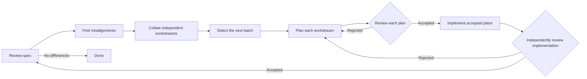
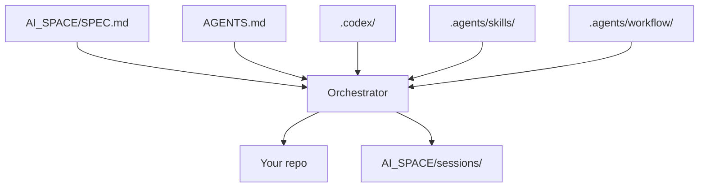

# InitAI

My base AI starting point for my projects.

Copy `AGENTS.md`, `AI_SPACE/`, `.codex/` and `.agents/` into whatever
repo you are in.

Write your spec at `AI_SPACE/SPEC.md`.

I use ChatGPT maxed out. Biggest model. Most reasoning. Q&A and brainstorm
style. My specs are normally 10 to 20k lines long. This is where you work out
what you actually want before six agents start having opinions about it.

Then write a prompt like this:

```
\goal Your [TERMINAL_CONDITION] is: "a 6 agent [SPEC_REVIEW] result which finds no difference between the spec and the repo". Please [ORCHESTRATE] until the [TERMINAL_CONDITION] is met.
```

Then come back in 10 to 20 days. Hopefully you have your spec. More likely,
you have your spec plus a useful list of things reality refused to cooperate on.

## The loop



The last review is always fresh. Something changed after the first review, so
the first review no longer proves anything.

## What each bit does



- `AGENTS.md` has the rules, workflow names and definition of done.
- `AI_SPACE/` has the spec, plans, reviews, evidence, handovers and TODOs.
- `.codex/` has the agents and their roles.
- `.agents/skills/` has the instructions for reviewing, planning and building.
- `.agents/workflow/` checks the workflow state, claims, scopes and handoffs.

The orchestrator does not get to mark its own homework. Plans are reviewed
before implementation. Implementations are reviewed by a different agent. A
rejected implementation goes back to planning. A clean full spec review is the
only `[DONE]`.

## Key skills

These are the ones that run the loop:

- `conformance` checks the repo against the full spec. It returns `PASS` or a
	list of findings.
- `outcome-decomposition` turns findings into independent workstreams.
- `select-ready-work` picks workstreams whose dependencies, scopes and shared
	resources do not collide.
- `plan` writes an implementation plan with scopes, validation and acceptance
	conditions.
- `plan-preflight` checks the mechanical bits before review.
- `plan-review` tries to reject the plan before anyone edits source code.
- `change-impact-analysis` works out what a change can break.
- `diagnose` finds the root cause when a failure needs investigation.
- `comprehensive-testing` decides what real evidence is needed.
- `done` checks the completion gate. It is only true after a fresh full clean
	conformance review.

The workflow uses these skills for specific jobs. They do not get to quietly
add new stages, widen a plan or turn a blocked task into a success.

## The DSL

The workflow DSL lives in `.agents/workflow/workflow.toml`. It is a small TOML
file for a fixed state machine. It tells the runner which role and skill own
each job, the verdicts each job may return, and where each verdict goes next.

```toml
version = 1
name = "spec-convergence"
max_agents = 6
preflight = "required"
independent_reviews = true
completion = "fresh_full_conformance"

[operations.conformance]
agent = "conformance-reviewer"
skill = "conformance"

[operations.conformance.transitions]
PASS = "done"
FINDINGS = "collate"
BLOCKED = "blocked"
```

The other operations are `collate`, `select`, `planning`, `plan_review`,
`implementation` and `implementation_review`. Their transitions make the loop
above. The runner rejects made-up operations, unknown roles, wrong verdicts,
missing evidence and unsafe scope overlaps.

Each agent returns a typed JSON result. For example, a clean conformance result
is only clean when it says it covered the full authority and gives an empty
findings list:

```json
{
	"operation": "conformance",
	"verdict": "PASS",
	"coverage": "full",
	"report": "AI_SPACE/sessions/session__YYYYMMDD_HHMMSS/evidence/conformance-final.md",
	"findings": []
}
```

The runner stores session state under `AI_SPACE/sessions/`. It reserves a task
before an agent starts it, records the result after it finishes, and asks what
is allowed next. It does not run models. It does not make judgement calls. It
just refuses to let the workflow pretend it happened.

## Using the runner directly

The runner needs Python 3.11+ and no third-party packages.

```sh
python .agents/workflow/run.py check --repo .
```

Start a session like this:

```sh
python .agents/workflow/run.py init --repo . --session AI_SPACE/sessions/session__YYYYMMDD_HHMMSS
python .agents/workflow/run.py next --repo . --session AI_SPACE/sessions/session__YYYYMMDD_HHMMSS
```

You probably want the orchestrator to run this instead of doing it by hand.
The details are in [.agents/workflow/README.md](.agents/workflow/README.md).

## The point

This is for big projects, long projects, research projects, or projects where
being subtly wrong is expensive. It is silly for a one-file script.

No stubs. No "looks good to me". No agent declaring victory because it made a
nice table. Keep going until the repo matches the spec.


